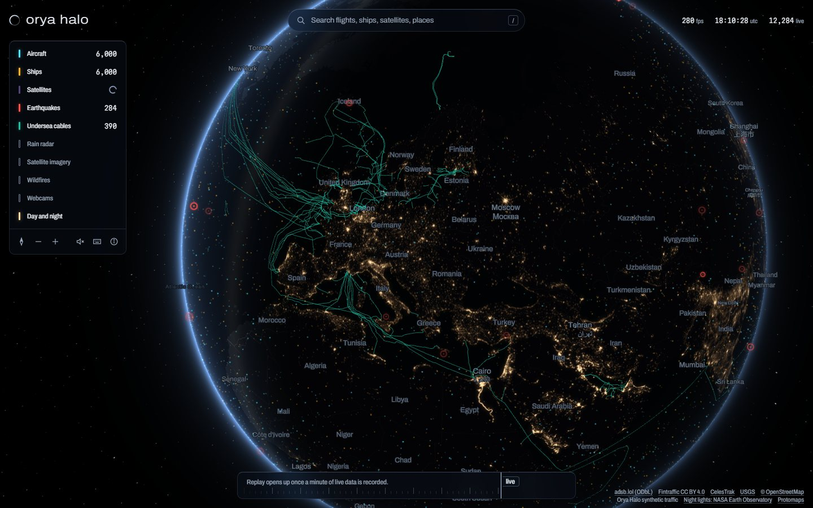
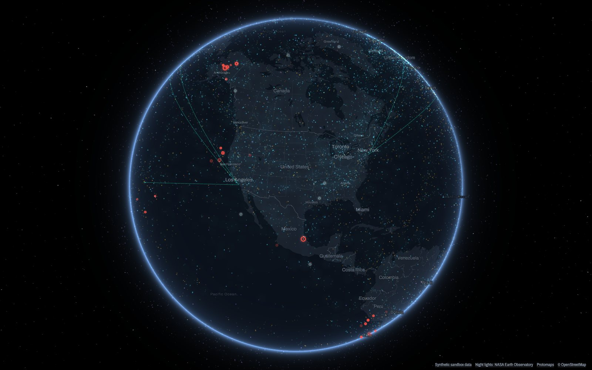
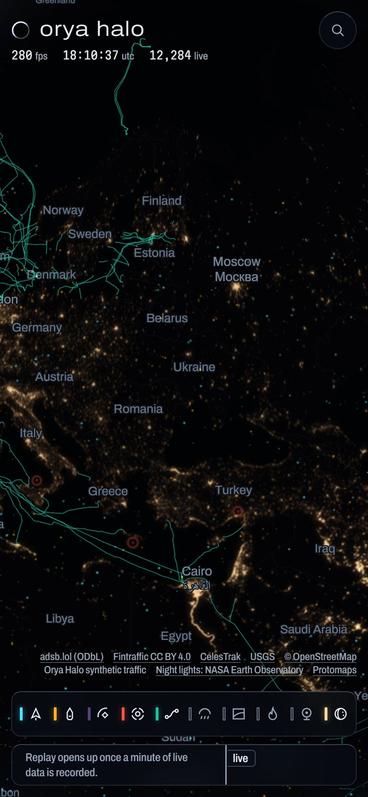

# Orya Halo

A real-time 3D globe of the planet's public live data: aircraft, ships, satellites, day and
night, undersea cables, earthquakes, rain radar, satellite imagery, wildfires and official
public webcams. It is a static web app (MapLibre and deck.gl, with motion computed on the GPU)
plus one small optional Rust service, the gateway, for the feeds a browser cannot or should
not reach on its own. Orya Halo is open source (MIT), non-commercial and display-only: it
shows free public feeds under their own terms and stores nothing about the people who look at
it.



<p>
  
  
</p>

The screenshots were taken with generated test traffic, not live positions.

## Contents

- [What you see](#what-you-see)
- [Quick start](#quick-start)
- [Keys: what works without them](#keys-what-works-without-them)
- [Project layout](#project-layout)
- [Configuration](#configuration)
- [Scripts](#scripts)
- [Keyboard shortcuts](#keyboard-shortcuts)
- [Performance budgets](#performance-budgets)
- [Deployment](#deployment)
- [Privacy](#privacy)
- [Licence](#licence)
- [Acknowledgements](#acknowledgements)

## What you see

From a country away, aircraft are drawn as 3D models of their real types (an A320, a 777, an ATR 72, a
Cessna, a helicopter), built from published dimensions and painted in simplified airline colour
schemes picked by callsign, and the 3D view rides behind one.

Every source was checked for terms that allow public display. The full table, with licences,
rate limits and the exact credit each provider asks for, is in
[docs/DATA_LICENCES.md](docs/DATA_LICENCES.md).

| Layer             | Source                                                                                                                                                                      | Needs                                       |
| ----------------- | --------------------------------------------------------------------------------------------------------------------------------------------------------------------------- | ------------------------------------------- |
| Aircraft          | [adsb.lol](https://www.adsb.lol/) (ODbL); flight routes from Virtual Radar Server standing data (CC0)                                                                       | the gateway                                 |
| Ships             | [Fintraffic Digitraffic](https://www.digitraffic.fi/en/marine-traffic/) (Finnish waters, CC BY 4.0); [AISStream.io](https://aisstream.io/) worldwide                        | the gateway; a free key for worldwide ships |
| Satellites        | [CelesTrak](https://celestrak.org/) orbital elements, propagated in the browser; a bundled snapshot fills in when CelesTrak cannot be reached                               | nothing                                     |
| Earthquakes       | [USGS](https://earthquake.usgs.gov/) (public domain)                                                                                                                        | nothing                                     |
| Undersea cables   | [OpenStreetMap](https://www.openstreetmap.org/copyright) (ODbL), baked into a bundled file                                                                                  | nothing                                     |
| Rain radar        | [RainViewer](https://www.rainviewer.com/) (or NASA IMERG, see [configuration](#configuration))                                                                              | nothing                                     |
| Satellite imagery | [NASA GIBS](https://nasa-gibs.github.io/gibs-api-docs/), VIIRS NOAA-20 true colour                                                                                          | nothing                                     |
| Wildfires         | [NASA FIRMS](https://firms.modaps.eosdis.nasa.gov/)                                                                                                                         | the gateway with a free key                 |
| Webcams           | Official traffic and road weather cameras: Fintraffic (Finland), Hong Kong Transport Department, Singapore LTA, DriveBC (British Columbia), City of Calgary, City of Austin | nothing                                     |
| Day and night     | Computed sun position; NASA Black Marble city lights                                                                                                                        | nothing                                     |
| Base map          | [Protomaps](https://protomaps.com/) tiles from OpenStreetMap                                                                                                                | nothing for zoom 0 to 5                     |

Aircraft photos in the detail panel come from [Planespotters.net](https://www.planespotters.net/),
fetched by the browser and credited to the photographer. Place search uses a bundled
[GeoNames](https://www.geonames.org/) extract.

## Quick start

### Prerequisites

| Tool                           | Version                                                                                    | Needed for                                    |
| ------------------------------ | ------------------------------------------------------------------------------------------ | --------------------------------------------- |
| [Node.js](https://nodejs.org/) | 22.18 or newer (`engines` in `package.json`)                                               | everything                                    |
| [pnpm](https://pnpm.io/)       | the repository pins 12.18.0 in `devEngines`; another pnpm downloads that version by itself | everything                                    |
| [Rust](https://rustup.rs/)     | 1.89 or newer, and a C compiler                                                            | the gateway only                              |
| Microsoft Edge                 | any current version                                                                        | the screenshot and browser check scripts only |

[Vite+](https://viteplus.dev/) (`vp`) is the toolchain. It is a dev dependency, so the
commands below work without installing it globally; a global `vp` is a convenience.

On Windows, use Git Bash, and before any Rust command run `source scripts/env.sh` from the
repository root (it puts cargo and gcc on the path).

### Install and fetch the base map

```sh
git clone https://github.com/dkampouridis/orya-halo.git
cd orya-halo
pnpm install
pnpm --filter @orya-halo/web tiles
```

The last command is a one-time step. It downloads a whole-world base map for zoom 0 to 5
(about 14 MiB, [PMTiles](https://docs.protomaps.com/pmtiles/), a single-file tile archive)
into `apps/web/public/tiles/world.pmtiles`, which git ignores, and restores the night-lights
texture if it is missing. It skips files that already exist. Without it the globe still runs,
with no base map, and says so.

### Run the web app alone

```sh
pnpm dev:web
```

Open the address it prints (normally <http://localhost:5173>). With no gateway, satellites,
earthquakes, cables, rain radar, satellite imagery, webcams and day and night all work:
they need no backend. Aircraft and ships show as offline, because in development the app
looks for a gateway at `ws://localhost:8787`. Add `?gateway=off` to the address to stop it
looking.

To see the app under load without any live traffic, add generated movers:
<http://localhost:5173/?gateway=off&synthetic=6000> (6,000 per gateway layer, up to 200,000).

### Run with the gateway

In a second terminal:

```sh
cd apps/gateway
cargo run --release
```

The first build can take a few minutes. The gateway listens on port 8787 and the web app finds it
by itself. With no keys it shows aircraft from adsb.lol and ships in Finnish waters from
Digitraffic. Check it with `curl http://localhost:8787/health`.

Run it from `apps/gateway`, as above: it reads a `.env` file from the directory it is started
in. (`pnpm gateway` at the root does the same build, but looks for `.env` at the root.)

### Mock mode

```sh
cd apps/gateway
cargo run --release -- --mock
```

Mock mode replaces every feed with a simulation (20,000 aircraft and 50,000 ships by default,
`--mock=aircraft:5000,ships:10000` for other numbers) and makes no outside requests. Use it to
work on the app without spending anyone's rate limit. The wildfire proxy is off in mock mode.

## Keys: what works without them

Nothing needs a key to start. Every key below is free.

| Key                  | Where it goes         | What it unlocks                                                                                                                                       |
| -------------------- | --------------------- | ----------------------------------------------------------------------------------------------------------------------------------------------------- |
| `ADSBLOL_API_KEY`    | `apps/gateway/.env`   | More aircraft requests: 1,000 a day with an [ad-hoc key](https://www.adsb.lol/request), 7,200 with a feeder key (also set `ADSBLOL_DAILY_QUOTA=7200`) |
| `AISSTREAM_API_KEY`  | `apps/gateway/.env`   | Ships worldwide, from [AISStream.io](https://aisstream.io/) (sign in with GitHub)                                                                     |
| `FIRMS_MAP_KEY`      | `apps/gateway/.env`   | The wildfire layer, from [NASA FIRMS](https://firms.modaps.eosdis.nasa.gov/api/map_key/)                                                              |
| `VITE_PROTOMAPS_KEY` | `apps/web/.env.local` | Street-level base map detail (zoom 6 and deeper), from [Protomaps](https://protomaps.com/). It ends up in the public bundle; Protomaps expects that   |

Copy `apps/gateway/.env.example` to `apps/gateway/.env`, and the root `.env.example` to
`apps/web/.env.local`, then fill in what you have. Both files are ignored by git. Never put a
secret in a `VITE_` variable: those are compiled into the page.

**Aircraft without a key are a demonstration, not a full sky.** adsb.lol allows 500 requests a
day per IP address without a key, each one a circle of at most 250 nautical miles, and covering
the Earth takes 1,236 such circles. The gateway spends that allowance carefully: it never goes
over it, it spends nothing while nobody is looking at aircraft, and it refreshes the area
people are looking at first. In practice:

| Key                  | First minutes                                                     | After that, while someone watches                                                                                 |
| -------------------- | ----------------------------------------------------------------- | ----------------------------------------------------------------------------------------------------------------- |
| none (500 a day)     | the area in view fills at once and stays live for about 8 minutes | one request every 3 min 12 s: the area in view refreshes a few times an hour, the rest of the world hardly at all |
| ad-hoc (1,000 a day) | 100 requests, one every 2 s                                       | one request every 96 s                                                                                            |
| feeder (7,200 a day) | 720 requests, one every 2 s                                       | one request every 13 s: an area in view stays close to live                                                       |

When the allowance runs low, the aircraft layer says so in its credit line and recovers by
itself. The whole world, live, needs adsb.lol's re-api, which only answers stations that feed
adsb.lol. The details are in [apps/gateway/README.md](apps/gateway/README.md).

## Project layout

```
apps/
  web/          The app: engine (MapLibre, deck.gl), data worker, controller, React HUD
    public/     Static assets: tile extract, cable and place files, night-lights texture
    scripts/    Asset fetchers, screenshot and browser check scripts
  gateway/      Rust service (Axum, Tokio): upstream feeds, H3 index, WebSocket fan-out
packages/
  schema/       Shared types, the layer list, the binary wire protocol, the plugin contract
  sources/      One plugin per data feed: fetch, normalise, licence, attribution
  layers/       deck.gl layers and shaders
docs/           Architecture, protocol, design, data licences, deployment, media
scripts/        env.sh (Rust on Windows), pnpm-locked.mjs (install mutex)
```

[H3](https://h3geo.org/) is a grid of hexagonal cells; the gateway files every aircraft and
ship under its cell so each browser gets only the cells in view. How the pieces fit together is
in [docs/ARCHITECTURE.md](docs/ARCHITECTURE.md); the gateway's wire format in
[docs/PROTOCOL.md](docs/PROTOCOL.md); the look and the words in [docs/DESIGN.md](docs/DESIGN.md).

## Configuration

Nothing is required. Two files list every variable with its default:

- **Web app:** [`.env.example`](.env.example) at the root. Copy it to `apps/web/.env.local`.
  Variables are read at build time and compiled into the bundle.
- **Gateway:** [`apps/gateway/.env.example`](apps/gateway/.env.example). Copy it to
  `apps/gateway/.env`, or set the variables in the environment. A test keeps this file in step
  with the code.

Web app variables:

| Variable             | Default                                                       | Meaning                                                     |
| -------------------- | ------------------------------------------------------------- | ----------------------------------------------------------- |
| `VITE_GATEWAY_URL`   | `ws://<host>:8787` in development, none in a production build | WebSocket address of the gateway. `off` runs without one    |
| `VITE_PMTILES_URL`   | none                                                          | Your own PMTiles archive for zoom 6 and deeper              |
| `VITE_PROTOMAPS_KEY` | none                                                          | Protomaps' hosted tiles for zoom 6 and deeper               |
| `VITE_RADAR_SOURCE`  | `rainviewer`                                                  | `imerg` for NASA's satellite rain estimate instead of radar |
| `VITE_REPO_URL`      | none                                                          | Repository address, for links on the about page             |

The gateway variables most deployments touch are `ALLOWED_ORIGINS`, `TRUST_PROXY`,
`UPSTREAMS`, the three keys above and `ADSBLOL_BUDGET_FILE`; see
[apps/gateway/README.md](apps/gateway/README.md#configuration).

Query flags, for development and testing:

| Flag               | Effect                                                             |
| ------------------ | ------------------------------------------------------------------ |
| `?gateway=off`     | Do not connect to a gateway                                        |
| `?synthetic=20000` | Add that many generated movers per gateway layer (at most 200,000) |
| `?fps=1`           | Show the frame-rate readout (always on in development)             |

The view itself lives in the address fragment, so copying the address shares it:
`#v=23.7275,37.9838,6.2,0,0&l=aircraft,ships,satellites&s=1.4ca7b5` is longitude, latitude,
zoom, bearing and pitch; the layers that are on; and the selected object (kind, then id in hex).

## Scripts

From the repository root:

| Command                              | What it does                                                                              |
| ------------------------------------ | ----------------------------------------------------------------------------------------- |
| `pnpm dev:web`                       | The web app's dev server (`pnpm dev` runs every package's `dev`, which today is the same) |
| `pnpm build`                         | Production build of the web app into `apps/web/dist`                                      |
| `pnpm test`                          | Every package's tests (Vitest, through `vp test run`)                                     |
| `pnpm typecheck`                     | TypeScript in every package                                                               |
| `pnpm lint`                          | Lint (`vp lint`, type-aware)                                                              |
| `pnpm fmt`                           | Format (`vp fmt`)                                                                         |
| `pnpm check`                         | Format check, lint and types together (`vp check`)                                        |
| `pnpm gateway`                       | Build and run the gateway (release)                                                       |
| `pnpm --filter @orya-halo/web tiles` | Fetch the base map extract and the night-lights texture                                   |

The gateway has its own (from `apps/gateway`): `cargo test`, `cargo clippy --all-targets -- -D warnings`,
`cargo fmt --check`, and `cargo run --release --example loadcheck`, a load test against a mock
gateway.

Browser scripts in `apps/web/scripts/` drive the installed Microsoft Edge through Playwright
and need the dev server running. Start it on the port the script expects, or pass `--base=`:

```sh
cd apps/web
pnpm exec vp dev --port 5181
node scripts/shot.mjs --base=http://localhost:5181
```

| Script                                  | What it does                                                                         |
| --------------------------------------- | ------------------------------------------------------------------------------------ |
| `shot.mjs`                              | Screenshots of the engine sandbox, or frame timings with `--perf`                    |
| `hud-shots.mjs`                         | Screenshots of the real HUD in every state, desktop and phone                        |
| `hud-check.mjs`                         | Drives the HUD with real input: shortcuts, search, time tape, dialogs, render counts |
| `check-interaction.mjs`                 | Picking, follow mode, flights, quality tiers in the sandbox                          |
| `check-alignment.mjs`                   | That MapLibre and deck.gl put the same coordinate on the same pixel                  |
| `check-overlays.mjs`                    | Raster overlays and a missing base map, with every tile answered locally             |
| `check-context-loss.mjs`                | That the globe comes back after the GPU context is lost                              |
| `check-padding.mjs`                     | Regression guard for a camera padding error on the first frame                       |
| `measure-bundle.mjs`                    | Builds the engine sandbox and prints what each file weighs                           |
| `fetch-tiles.mjs`, `fetch-textures.mjs` | The asset fetchers behind `tiles`                                                    |

`shot.mjs` and the `check-*` scripts other than `check-padding.mjs` default to port 5181;
`hud-*.mjs` and `check-padding.mjs` default to 5183. Screenshots go to `.screenshots/`, which
git ignores. The scripts that load the real app (`hud-*.mjs`, `check-padding.mjs`) contact the
live providers on every page load, so run them sparingly.

The engine sandbox, `/sandbox.html` on the dev server, mounts the globe alone with synthetic
data and is driven by its query string (`?n=50000&zoom=3&quality=low`); the options are listed
at the top of `apps/web/src/dev/sandbox.ts`.

The bundled cable and place files are rebuilt from OpenStreetMap and GeoNames with
`vp node scripts/build-cables.ts` and `vp node scripts/build-places.ts` in `packages/sources`
(`vp node` needs the global `vp` command). Each sends a handful of requests to a public
service; do not run them in a loop.

The satellite snapshot (`apps/web/public/data/satellites.csv`, with its date range in
`satellites.json`) is what the app shows when CelesTrak cannot be reached. Refresh it with
`vp node scripts/build-satellites.ts` in `packages/sources`. CelesTrak allows one download per
group per update (about every two hours) from each address, so prefer
`--from <file>` with a copy you already have, or `--url` pointing at your gateway's
`/v1/proxy/celestrak/active.csv`.

## Keyboard shortcuts

| Key        | Does                                                                                                      |
| ---------- | --------------------------------------------------------------------------------------------------------- |
| `/`        | Search                                                                                                    |
| `1` to `0` | Turn a layer on or off, in dock order                                                                     |
| `F`        | Follow the selected object                                                                                |
| `V`        | 3D view: ride behind the selected aircraft (wheel: nearer or further; drag: turn round it or look down)   |
| `Esc`      | Close search, then clear the selection                                                                    |
| `←` `→`    | Move through time, with the time tape focused (Shift or Page keys: five minutes; Home: oldest; End: live) |
| `L`        | Back to live                                                                                              |
| `+` `−`    | Zoom in and out                                                                                           |
| `N`        | Face north                                                                                                |
| `H`        | Return to your region                                                                                     |
| `M`        | Sound on or off                                                                                           |
| `?`        | Show the list of shortcuts                                                                                |

Shortcuts are ignored while typing in a field, with Ctrl, Alt or Cmd held, and while a dialog
is open.

## Performance budgets

| Budget           | Target                            | How it is met                                                                                                                                                                                                             |
| ---------------- | --------------------------------- | ------------------------------------------------------------------------------------------------------------------------------------------------------------------------------------------------------------------------- |
| Entry JavaScript | under 300 KB gzipped              | The HUD shell only; the engine and layers are loaded with dynamic imports                                                                                                                                                 |
| Frame rate       | 60 fps with 20,000 or more movers | [Dead reckoning](https://en.wikipedia.org/wiki/Dead_reckoning) (moving each object on from its last fix by heading and speed) runs in the vertex shader; one instanced draw per layer; no per-object JavaScript per frame |
| Under load       | degrade, do not stutter           | Quality tiers: fewer tails, lower device pixel ratio, density instead of points                                                                                                                                           |
| Memory           | flat over an hour                 | Fixed-size ring buffers, entity expiry, buffers transferred between threads rather than copied                                                                                                                            |

How to measure:

- **Entry JavaScript:** `pnpm build` and read the gzip column for `index-*.js` and the chunks
  `dist/index.html` preloads. On 2026-11-14 that was about 134 KB gzipped of JavaScript plus
  7 KB of CSS.
- **Engine size:** `node scripts/measure-bundle.mjs` in `apps/web` (about 540 KB gzipped on
  2026-11-14, fetched after the HUD is up).
- **Frame rate:** with the dev server on port 5181, `node scripts/shot.mjs --perf --headed --query="n=20000"`
  prints frame statistics as JSON. In the app, `?fps=1&synthetic=20000` shows a live readout.
  Use `--headed`: a headless browser has no display to pace frames against.
- **Memory:** there is no script yet. Leave `?synthetic=20000` open for an hour and watch the
  tab in the browser's task manager.
- **Gateway:** `cargo run --release --example loadcheck` in `apps/gateway`; the gateway README
  has the results of past runs.

## Deployment

The web app is static files. The gateway is one long-running process. In short:

- **Frontend:** `pnpm --filter @orya-halo/web tiles && pnpm build`, then publish
  `apps/web/dist` on any static host, such as Cloudflare Pages or Vercel. The largest file is
  the 14 MiB tile extract, which is why it stops at zoom 5: Cloudflare Pages refuses files over
  25 MiB, and zoom 6 would be about 43 MiB. Set `VITE_GATEWAY_URL` (a `wss://` address) at
  build time, or the production build runs without aircraft, ships and wildfires.
- **Gateway:** the [Dockerfile](apps/gateway/Dockerfile) on Fly.io ([fly.toml](apps/gateway/fly.toml))
  or any small VPS. Run exactly one instance, set `ALLOWED_ORIGINS` to your site, and keep the
  keys in the host's secrets.
- **Why not serverless for the gateway:** every visitor holds a WebSocket open for as long as
  the tab is open, the world state lives in memory, and upstream connections and rate limits
  must be shared by everyone. A function that sleeps between requests can do none of that.

[docs/DEPLOYMENT.md](docs/DEPLOYMENT.md) has the full version, including what has not been
tested yet: the Docker image and the Fly.io configuration have never been built or run.

## Privacy

- No accounts, no cookies, no analytics, no tracking.
- The opening shot guesses your region from your device's time zone. The app never asks for
  your location.
- The browser keeps two things on your device: whether the ambient hum is on, and copies of
  provider responses so it does not ask a rate-limited provider twice.
- Your browser fetches most open feeds from their providers itself: satellite orbital
  elements (from the gateway's shared cache when one is configured), USGS, RainViewer, NASA, Fintraffic, Hong Kong's Transport Department,
  the traffic camera publishers (data.gov.sg, the B.C. Data Catalogue and DriveBC, and the
  Calgary and Austin open data portals and camera hosts), Planespotters.net when you select an aircraft, and Protomaps if a key is configured. Those
  providers see your IP address, as with any web request.
- The gateway does not log visitors' addresses. It counts connections per address in memory
  to enforce its limits.

## Licence

The code is MIT licensed: see [LICENSE](LICENSE).

The data is not. Each feed is shown under its provider's terms, listed in
[docs/DATA_LICENCES.md](docs/DATA_LICENCES.md), and its credit is shown in the app. The
undersea cable file (`apps/web/public/data/cables.bin`), the base map extract and the aircraft
positions the gateway relays are databases derived from OpenStreetMap and adsb.lol, offered
under the [ODbL 1.0](https://opendatacommons.org/licenses/odbl/1-0/) share-alike licence, not
under MIT. If you publish a database derived from them, it has to be offered under the ODbL
too.

Contributions are welcome: see [CONTRIBUTING.md](CONTRIBUTING.md) and our
[code of conduct](CODE_OF_CONDUCT.md). Security problems: [SECURITY.md](SECURITY.md).

## Acknowledgements

The data comes from people and agencies who publish it openly: adsb.lol and the people who
feed it, Fintraffic, AISStream.io, CelesTrak and the U.S. Space Force, the U.S. Geological
Survey, OpenStreetMap contributors, Protomaps, RainViewer, NASA (GIBS, FIRMS, Earth
Observatory), the Hong Kong Transport Department, Singapore's Land Transport Authority, the
B.C. Ministry of Transportation and Transit, The City of Calgary, Austin Transportation and
Public Works, Planespotters.net and its photographers,
GeoNames, and the Virtual Radar Server standing data project.

Built on [MapLibre GL JS](https://maplibre.org/), [deck.gl](https://deck.gl/),
[PMTiles](https://github.com/protomaps/PMTiles), [satellite.js](https://github.com/shashwatak/satellite-js),
[h3-js](https://github.com/uber/h3-js) and [h3o](https://github.com/HydroniumLabs/h3o),
[React](https://react.dev/), [Zustand](https://zustand.docs.pmnd.rs/),
[TanStack Query](https://tanstack.com/query), [Base UI](https://base-ui.com/),
[Axum](https://github.com/tokio-rs/axum) and [Tokio](https://tokio.rs/), with the Archivo and
Martian Mono typefaces through [Fontsource](https://fontsource.org/), and
[Vite+](https://viteplus.dev/).

Created in [T3 Code](https://t3.codes).
